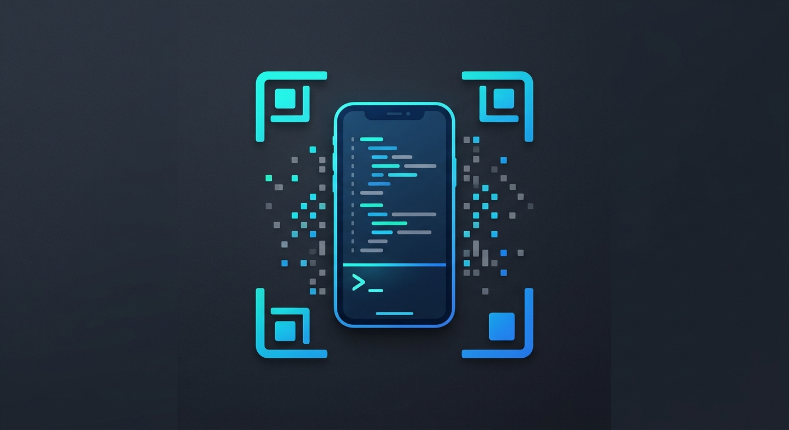
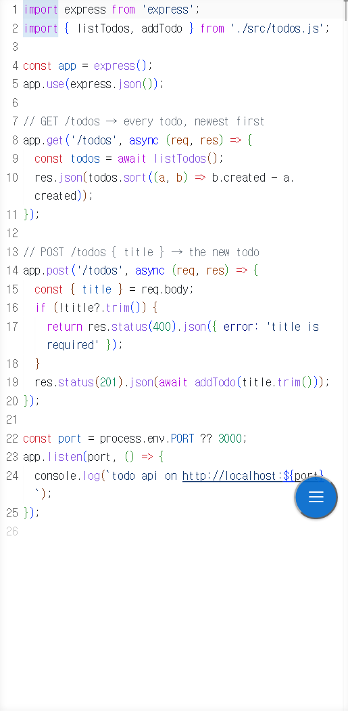
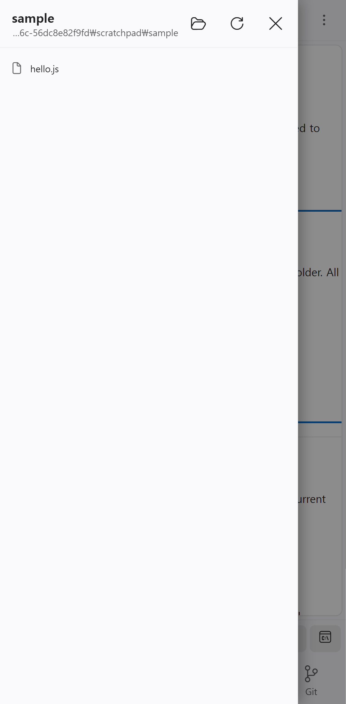
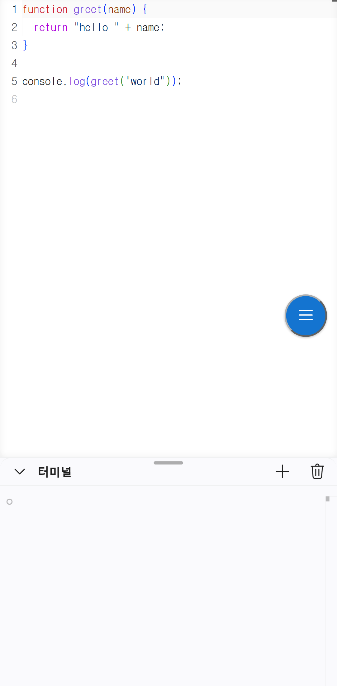
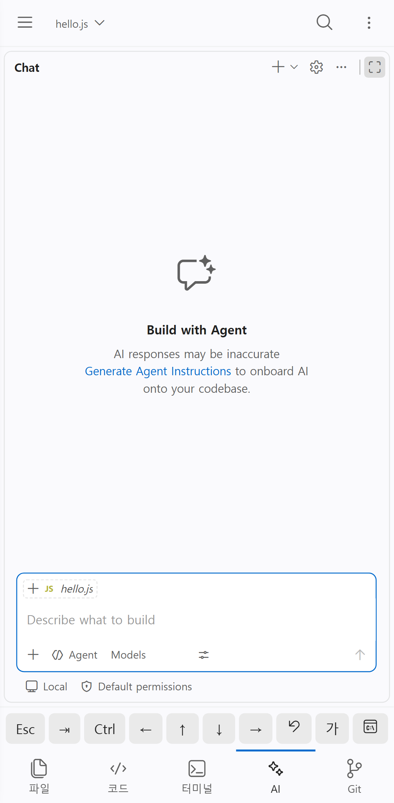

# handide: VS Code on your phone

Press the phone button in the status bar, scan the QR code, and keep working on this project from your phone: your own VS Code, your extensions and your AI agents (Claude Code, Codex, …), with a touch layout made for a phone. Your files stay on your PC; the phone is just a screen.

<table>
  <tr>
    <td align="center"> Code, edge to edge</td>
    <td align="center"> Files drawer</td>
    <td align="center"> Terminal drawer</td>
    <td align="center"> AI chat</td>
  </tr>
</table>

## Requirements

This extension is the button; [handide](https://github.com/YangJongWon/handide) does the serving. Install it once on the PC:

- **Windows:** run `handide-setup-<version>.exe` from [Releases](https://github.com/YangJongWon/handide/releases/latest).
- **Any OS (Node.js 20+):** `npm install -g github:YangJongWon/handide`

## Use

1. Open a folder in VS Code.
2. Press the **phone button** in the status bar (or run **handide: Open on Phone**).
3. Scan the QR code with the phone camera.

When handide is not running yet, the button starts it. It keeps running after VS Code closes, so the phone stays connected; `handide service install` starts it at logon.

- **Same Wi-Fi:** works right away. The first visit shows a certificate warning once, because handide makes its own certificate for your PC.
- **Away from home:** run `handide remote` once. The QR code then works on mobile data too, with nothing to install on the phone.

The link contains your access token: use it only on your own devices.

## Other PCs

With handide on several PCs signed in to the same Tailscale account, the **PCs** button opens a project of another PC where it lives (through Remote - SSH), or moves it to run on this PC.

## Settings

- `handide.port`: the port handide runs on (default `9000`).
